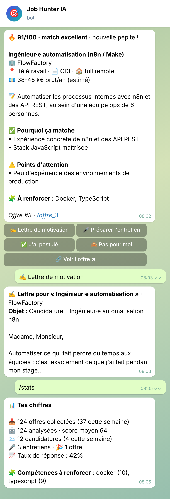
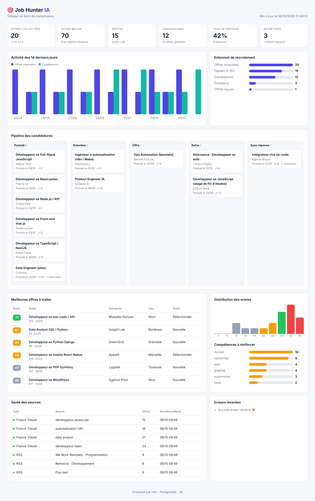
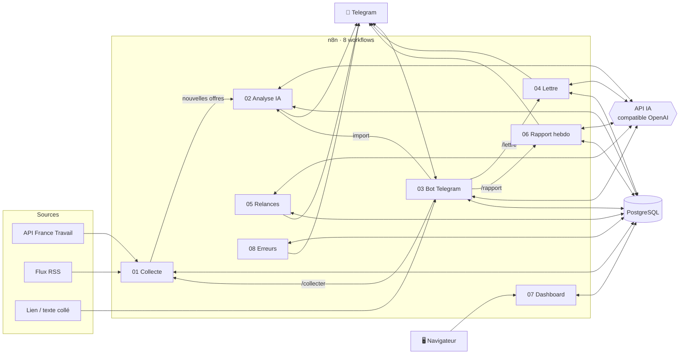
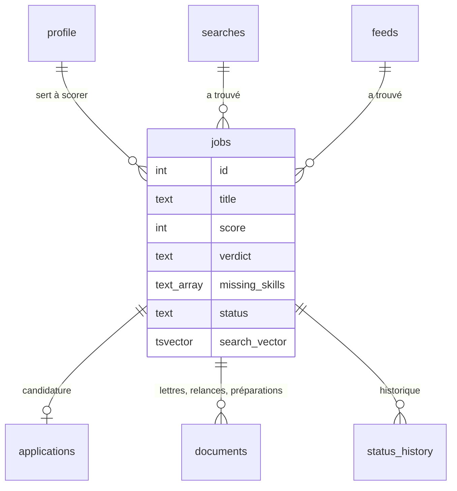

# 🎯 Job Hunter IA

**Un assistant de recherche d'emploi 100 % automatisé, construit avec n8n, PostgreSQL et l'IA.**

Il collecte les offres, les compare à ton CV, t'alerte sur Telegram quand une offre te correspond vraiment, rédige tes lettres de motivation, prépare tes entretiens, te rappelle quand relancer et suit tout ton pipeline sur un dashboard.


<p align="center">
  
  &nbsp;&nbsp;
  
</p>

---

## ✨ Fonctionnalités

| | Fonctionnalité | Détail |
|---|---|---|
| 📥 | **Collecte multi-sources** | API officielle **France Travail** (OAuth2) + **flux RSS** (remote, international). Dédoublonnage, santé des sources, désactivation automatique d'un flux cassé. |
| 🤖 | **Scoring IA personnalisé** | Chaque offre est comparée à **ton CV** : score 0-100, verdict, points forts, écarts, **compétences manquantes**, signaux d'alerte, salaire estimé, niveau, télétravail. |
| 🔔 | **Alertes « pépites »** | Seules les offres au-dessus de ton seuil t'arrivent sur Telegram, avec des **boutons d'action**. |
| ✍️ | **Lettre de motivation sur mesure** | Rédigée à partir de l'offre et de ton CV (sans rien inventer), avec email d'accompagnement, conseils et fichier `.txt` éditable. |
| 🎤 | **Préparation d'entretien** | Pitch de 45 s, questions probables avec pistes de réponse, sujets à réviser, questions à poser, pièges à éviter. |
| 📎 | **Import d'offres trouvées ailleurs** | Colle un **lien** (lecture des données `JobPosting` schema.org) ou le **texte** d'une offre : l'IA l'extrait et l'analyse. |
| 📄 | **Profil depuis ton CV** | Envoie ton CV en PDF au bot : compétences, expérience et postes visés sont extraits automatiquement. |
| ⏰ | **Relances automatiques** | À J+7 sans réponse, l'IA rédige un email de relance. Après 2 relances, la candidature passe en « sans réponse ». |
| 📊 | **Rapport hebdo + coach IA** | Chaque lundi : tes chiffres, ton taux de réponse, les compétences les plus demandées qui te manquent, 3 actions concrètes. |
| 💬 | **Coach carrière** | Pose n'importe quelle question au bot : il répond avec le contexte de ton profil et de tes candidatures. |
| 📈 | **Dashboard web** | KPIs, entonnoir, activité sur 14 jours, pipeline kanban, distribution des scores, santé des sources, erreurs. Thème clair/sombre. |
| 🚨 | **Supervision** | Workflow d'erreurs global : chaque panne est journalisée en base et signalée sur Telegram. |

## 🏗️ Architecture



| Workflow | Déclencheur | Rôle |
|---|---|---|
| **01 · Collecte des offres** | Toutes les 4 h (8h-20h), `/collecter` | Interroge France Travail et les flux RSS, normalise, dédoublonne, enregistre |
| **02 · Analyse IA des offres** | Après la collecte, toutes les 30 min, import manuel | Réserve les offres (`FOR UPDATE SKIP LOCKED`), score IA, alertes |
| **03 · Bot Telegram** | Messages et clics Telegram | Routeur de 25+ commandes, import, CV, coach IA |
| **04 · Lettre de motivation** | Sous-workflow | Lettre + email + conseils, envoi en message et en fichier |
| **05 · Relances automatiques** | En semaine à 9h | Relances à J+7, classement « sans réponse » |
| **06 · Rapport hebdo & coaching** | Lundi 8h, `/rapport` | Statistiques + coaching IA |
| **07 · Dashboard web** | `GET /webhook/jobhunter` | Page HTML générée depuis PostgreSQL |
| **08 · Alertes erreurs** | Erreur dans un workflow | Journalisation + alerte Telegram |

### Base de données



- **Recherche plein texte** en français (`tsvector` généré + index GIN) pour `/chercher`
- **Trigger** qui historise chaque changement de statut (funnel et rapport hebdo)
- **Vues** `v_pipeline` et `v_missing_skills` pour les statistiques
- **Base séparée** pour n8n (workflows, exécutions, identifiants chiffrés)

## 🚀 Installation (≈ 10 minutes)

### Prérequis

- [Docker Desktop](https://www.docker.com/products/docker-desktop/) (ou Docker + Compose)
- Une **clé d'API IA** compatible OpenAI ([OpenAI](https://platform.openai.com/api-keys), [Mistral](https://console.mistral.ai/), [Groq](https://console.groq.com/), [OpenRouter](https://openrouter.ai/)…)
- Un **bot Telegram** : écris `/newbot` à [@BotFather](https://t.me/BotFather) et garde le token
- *(Recommandé)* Une application [France Travail](https://francetravail.io/) avec l'API **« Offres d'emploi v2 »**
- *(Pour le bot)* Un compte gratuit [ngrok](https://dashboard.ngrok.com/) avec un domaine statique gratuit

### 1. Configurer

```bash
git clone https://github.com/mamadouwhile/job-hunter-ia.git
cd job-hunter-ia
cp .env.example .env
```

Remplis dans `.env` les lignes marquées 👉 (clé IA, token Telegram, identifiants France Travail, ngrok). Les mots de passe et la clé de chiffrement sont **générés automatiquement**.

### 2. Lancer

```bash
bash scripts/setup.sh
```

Le script démarre PostgreSQL (schéma + données de départ), crée les identifiants n8n depuis `.env`, importe et publie les 8 workflows, puis lance n8n.

### 3. Connecter Telegram

1. Écris `/start` à ton bot : s'il ne te connaît pas encore, il te répond avec **ton identifiant**.
2. Mets-le dans `TELEGRAM_CHAT_ID` puis relance `bash scripts/setup.sh`.
3. **Envoie ton CV en PDF** au bot pour remplir ton profil, puis `/collecter`.

> **Pourquoi un tunnel HTTPS ?** Telegram envoie les messages à ton bot via un webhook HTTPS public. En local, ngrok expose n8n sur `https://ton-domaine.ngrok-free.app` : renseigne `NGROK_AUTHTOKEN`, `NGROK_DOMAIN` et `N8N_WEBHOOK_URL=https://ton-domaine.ngrok-free.app/`. Sur un serveur avec un nom de domaine, mets simplement ton URL HTTPS.

### 4. Ouvrir

- **n8n** : http://localhost:5678 (crée ton compte au premier accès)
- **Dashboard** : `/dashboard` dans Telegram, ou http://localhost:5678/webhook/jobhunter?token=TON_DASHBOARD_TOKEN
- **Démo** : pour voir le dashboard rempli tout de suite :
  ```bash
  docker compose exec -T postgres psql -U jobhunter -d jobhunter < database/demo-data.sql
  ```

## 🤖 Commandes du bot

| Commande | Action |
|---|---|
| `/offres` | Tes 10 meilleures offres du moment |
| `/offre_12` | Fiche détaillée de l'offre 12 avec boutons d'action |
| `/chercher react télétravail` | Recherche plein texte dans toutes les offres |
| `/collecter` | Lance une collecte immédiatement |
| `/lettre_12` | Lettre de motivation sur mesure |
| `/postuler_12` | Marque l'offre comme postulée (relance planifiée à J+7) |
| `/entretien_12` | Préparation d'entretien par l'IA |
| `/statut 12 entretien` | Met à jour le statut (`entretien`, `offre`, `refus`, `ignore`, `postulé`) |
| `/candidatures` | Ton pipeline de candidatures |
| `/stats` · `/rapport` | Tes chiffres · rapport + coaching IA |
| `/dashboard` | Lien vers le tableau de bord |
| `/profil` · `/seuil 75` · `/reanalyser` | Profil · seuil d'alerte · recalcul des scores |
| `/recherches` · `/recherche_ajouter dev react \| 69 \| CDI` · `/recherche_retirer 3` | Gérer les recherches France Travail |
| `/flux` · `/flux_ajouter <url> <nom>` · `/flux_retirer 2` | Gérer les flux RSS |
| 📎 *lien ou texte d'offre* | Import + analyse IA |
| 📄 *CV en PDF* | Mise à jour du profil |
| 💬 *question libre* | Coach carrière IA |

## 🧠 Choix techniques

- **Prompts structurés et validés** : chaque appel IA demande un JSON strict (`response_format`), validé et nettoyé en JavaScript (bornes, types, valeurs autorisées) avant d'être enregistré.
- **Indépendant du fournisseur d'IA** : appels HTTP au format OpenAI ; changer de modèle ou de fournisseur = 2 variables (`LLM_BASE_URL`, `LLM_MODEL`).
- **Robustesse** : retries sur les appels IA, `continueOnFail` sur les sources externes, réservation des offres (`FOR UPDATE SKIP LOCKED`) pour éviter les doubles analyses, nombre de tentatives limité, workflow d'erreurs global.
- **Sécurité** : bot limité à ton seul compte Telegram, dashboard protégé par token, PostgreSQL exposé uniquement en local, identifiants chiffrés par n8n et créés à partir de `.env` sans jamais être écrits sur le disque.
- **Installation reproductible** : identifiants et workflows importés par la CLI n8n avec des identifiants fixes, ce qui permet aux workflows de s'appeler entre eux dès l'import.
- **Économe** : un seul appel IA par offre, plafonné à 15 offres par lot, prompts tronqués ; avec `gpt-4o-mini`, l'analyse de 100 offres coûte environ quelques centimes.

## 📁 Structure

```
job-hunter-ia/
├── docker-compose.yml        # PostgreSQL + n8n (+ ngrok en option)
├── .env.example              # Toute la configuration
├── database/
│   ├── 00-n8n-database.sql   # Base interne de n8n
│   ├── 01-schema.sql         # Tables, index, trigger, vues
│   ├── 02-seed.sql           # Profil, recherches et flux de départ
│   └── demo-data.sql         # Jeu de démonstration (optionnel)
├── workflows/                # Les 8 workflows n8n (JSON)
├── scripts/
│   ├── setup.sh              # Installation en une commande
│   ├── install-workflows.sh  # Import identifiants + workflows (dans le conteneur)
│   └── build-credentials.js  # Génère les identifiants n8n depuis .env
└── docs/
    ├── screenshots/
    └── post-linkedin.md
```

## 🛣️ Pistes d'évolution

- [ ] Candidature en un clic par email (nœud Gmail) avec la lettre en pièce jointe PDF
- [ ] Synchronisation des entretiens avec Google Agenda
- [ ] Scoring par embeddings (pgvector) pour pré-filtrer avant l'appel IA
- [ ] Sources supplémentaires : Welcome to the Jungle, LinkedIn Jobs, Indeed
- [ ] Mode multi-utilisateur

## ⚖️ Licence et données

Code sous licence **MIT**. n8n est distribué sous [Sustainable Use License](https://github.com/n8n-io/n8n/blob/master/LICENSE.md) : ce dépôt ne contient que des workflows et une configuration, pas le code de n8n.
Les données des offres proviennent de l'API France Travail et des flux RSS configurés ; respecte leurs conditions d'utilisation. La capture du bot dans ce README est une maquette illustrative, et les entreprises du jeu de démo sont fictives.
